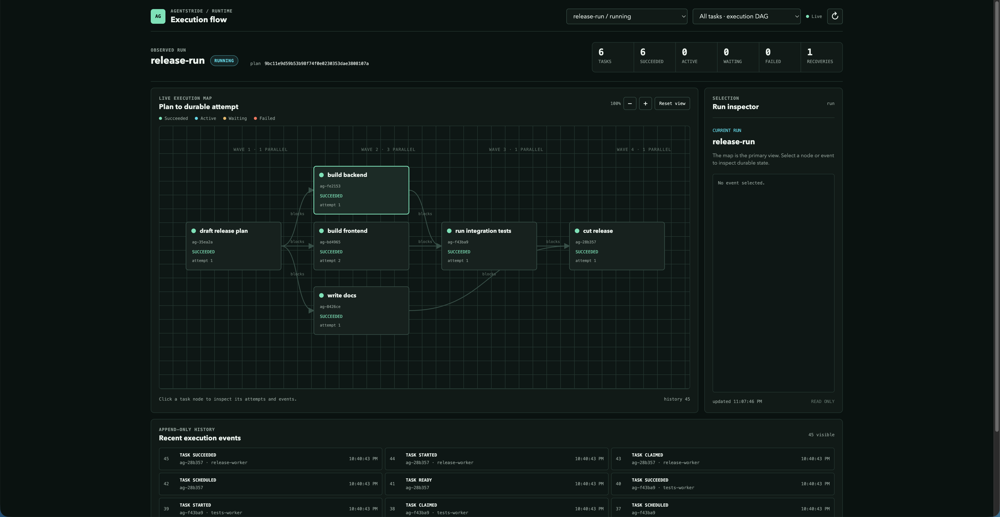

# AgentStride

> Durable execution for long-running agent work.

AgentStride is a local-first runtime, written in Rust, for coding agents that
do long, multi-step work. It keeps the **plan in Git** and the **execution
history in SQLite**, so a run survives everything that normally kills a
long agent job: lost context, worker crashes, expired leases, retries,
process restarts, and plan changes made mid-flight.

When something goes wrong, recovery is not guesswork — it is derived from an
append-only history that records exactly what happened, in order, forever.



*The read-only web console replaying a finished run: four scheduling waves,
three branches executed in parallel by three workers, and one branch that
failed once and recovered behind a durable retry timer.*

## Why

Long-running agent work is not a normal task queue:

- **The plan changes while work is in progress.** An LLM that plans is allowed
  to change its mind. AgentStride stores the plan as versioned data, so
  changing it requires an explicit, approved revision — never a silent rewrite.
- **Agents crash or lose context halfway through a task.** Every attempt has a
  transactional lease and a signed capability token. When the lease expires,
  the work is recovered and handed to another worker; a stale worker that
  comes back late is fenced off instead of overwriting newer results.
- **Retries must not corrupt state.** Tasks retry behind persistent timers,
  and every retry is a new, explicitly numbered attempt in history.
- **You need to explain what happened.** State and events commit together in
  one transaction, so history can always rebuild and verify the current state.

AgentStride treats the plan as data and execution as an append-only state
machine. A reconciler joins the two without rewriting completed history.

## How it works

```text
Git PlanRevision
        |
        v
Run -> Durable Task -> Worker Attempt
 |                         |
 +-> History <-------------+
        |
        +-> checkpoint / retry / timeout / recovery / handoff
```

- The **plan layer** is a set of tasks and `blocks` edges exported as JSONL
  into Git. A revision is immutable; changing the plan means proposing and
  approving a new revision.
- The **runtime layer** is a SQLite event log plus materialized task state.
  A run executes one plan revision. Ready work is derived from authoritative
  state — including diamond and fan-in dependencies, not just chains — so
  independent branches run concurrently under separate leases.
- The **reconciler** compares the current revision to the run and computes
  discovered, ready, invalidated, and superseded work. Completed tasks are
  never silently rerun when the plan changes.

Key guarantees:

- scheduling edges remain acyclic;
- ready work is derived from authoritative state;
- claims and leases are transactional;
- stale attempts are fenced by signed tokens;
- state and events commit together;
- history can rebuild and verify materialized runtime state;
- plan changes require an approved revision;
- replay is explicit and idempotent.

## Quick Start

```bash
cargo build --bin as

as init
as add "Design storage"
as add "Implement storage"
as link <implement-id> --blocks <design-id>
as ready --json
as claim-next --actor worker-a --json
```

The command is `as`; the project and crate are `agent-stride`. One binary,
one SQLite file, no server — everything runs on your machine.

## Demos

### Parallel branches

Builds a release DAG — one root, three parallel branches, a three-way join,
and a final release gate — and executes it with three concurrent workers. One
branch fails on purpose, parks behind a durable retry timer, and recovers
without blocking the others. The script asserts wave scheduling, dependency
gating, recovery, and history integrity, then prints the evidence as JSON.

```bash
./scripts/parallel-branches-demo.sh
cargo test --test parallel_branches
```

Open the generated workspace in the web console to see the branching
execution map from the screenshot above.

### Crash and recovery

Creates a Git-backed plan, starts a run, kills a worker mid-attempt, recovers
the expired lease, evolves the plan through an approved revision, and verifies
the final state.

```bash
./scripts/durable-runtime-demo.sh
cargo run --bin as-eval -- --variant runtime --scenario chain --agents 2 --seed 7
```

### Web console

Runs the durable demo and opens the read-only observability UI immediately:

```bash
./scripts/observability-demo.sh
```

The UI never mutates state. It replays history: the execution map draws the
plan as a branching DAG with wave labels, task nodes drill down into their
attempt lifecycle, and the event panel streams the append-only log.

## Interfaces

- **CLI (`as`)** — the stable human and automation surface, with JSON output.
- **MCP (`as mcp`)** — a local stdio MCP server for agent integration.
- **Web console (`as ui`)** — read-only replay of a run.
- **Deterministic evaluator (`as-eval`)** — exercises chains, diamonds,
  retries, timeouts, handoffs, recovery, and plan evolution with fake workers,
  no model API key needed.

## Checks

```bash
cargo fmt --all -- --check
cargo clippy --all-targets --all-features -- -D warnings
cargo test --all-targets
cargo bench --bench engine -- --noplot
```

The deterministic evaluator and benchmark report are evidence for local
correctness and behavior, not production-scale performance claims.

## Documentation

- [Architecture](docs/architecture.md)
- [Runtime model](docs/runtime.md)
- [Development and verification](docs/development.md)

## License

MIT
